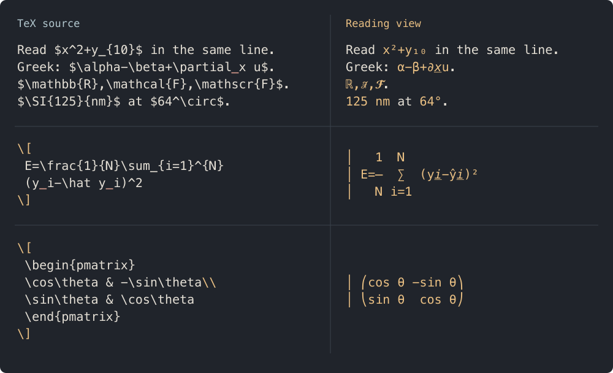
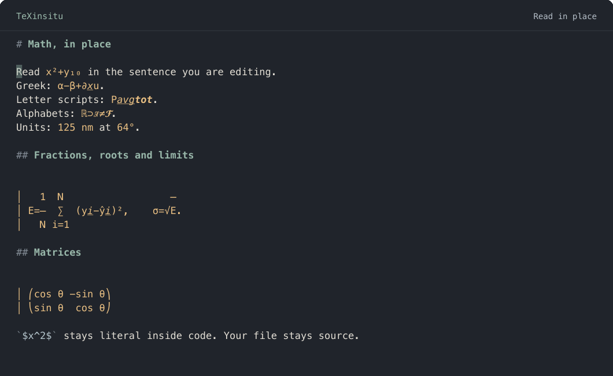

# TeXinsitu

**Read mathematics. Edit TeX. In the same place.**

TeXinsitu renders formulas inside your TeX, Markdown and Cogitatum source in
Vim. Move into a formula to edit its TeX; move out to read it again.



*Source and reading views of [the same example](examples/demo.md), captured
from terminal Vim with Menlo. The comparison uses Vim's actual cells and styles.*

- **Stay in the paragraph.** Inline math lives beside your prose. Fractions,
  roots, sums and matrices get two-dimensional layouts in display equations.
- **Keep writing naturally.** Your macros and `siunitx` units work too. Enter
  an equation block to reveal the whole block; nearby formulas keep rendering.
- **Keep the source.** Yank, search, undo and save operate on the original TeX.
- **Keep it quick.** One resident Rust process caches formulas; moving the
  cursor repaints only the affected formulas.

<details>
<summary>Watch the cursor reveal a formula and a whole equation block</summary>



The source stays in its original position. Move out to render it again.

</details>

## Install

Vim **9.0.0121+** with `+textprop`, `+conceal` and `+job` is required.
Terminal Vim and MacVim are supported; Neovim is not.

With vim-plug:

```vim
Plug 'BaksiLi/texinsitu.vim', {'do': ':TexInsituInstall'}
```

The install hook downloads a prebuilt kernel for the plugin's version and
checks its SHA-256. Run `:PlugInstall` to install, or `:PlugUpdate` to update.
**Rust is not needed** for the prebuilt platforms:

| macOS | Linux | Windows |
| --- | --- | --- |
| Apple silicon, Intel | ARM64, x86-64 (musl) | x86-64 |

For native Vim packages:

```sh
git clone https://github.com/BaksiLi/texinsitu.vim.git ~/.vim/pack/plugins/start/texinsitu.vim
```

Then run `:TexInsituInstall` in Vim. Run it again after updating the plugin.
Downloads happen only when you install or update the kernel.

<details>
<summary>Build from source or use another platform</summary>

Install Rust, then run in the plugin directory:

```sh
cargo build --release --locked --manifest-path kernel/Cargo.toml
```

For vim-plug, use this build hook instead:

```vim
Plug 'BaksiLi/texinsitu.vim', {'do': 'cargo build --release --locked --manifest-path kernel/Cargo.toml'}
```

</details>

## Use

Open a `.tex`, Markdown or Cogitatum file. Rendering is automatic.
`:TexInsituToggle` switches the current buffer to raw source and back.
There are no default key mappings. See `:help texinsitu` for the reference.

| TeX source | Reading view |
| --- | --- |
| `x^2+y_{10}` | x²+y₁₀ |
| `\alpha-\beta+\partial u` | α−β+∂u |
| `\mathbb{R}\supset\mathcal{F}\ne\mathscr{F}` | ℝ⊃ℱ≠𝓕 |
| `\SI{125}{nm}` at `64^\circ` | 125 nm at 64° |

Letter scripts use Vim styling, as shown in the demo. Numeric scripts use
Unicode digits. Display equations are centred vertically on their source
lines, with a label beside the final row when space permits.

Document `\newcommand` and `\DeclareMathOperator` definitions are included;
with VimTeX, so are definitions from the main file when editing a child file.
Comments, verbatim text, URLs and Markdown code stay literal. An unfinished
or unsupported formula stays editable source as a whole.

| Setting | Default |
| --- | --- |
| `g:texinsitu_filetypes` | `['tex', 'markdown', 'cogitatum']` |
| `g:texinsitu_enabled`, `b:texinsitu_enabled` | `1` |

Style the `TexInsitu`, `TexInsituSub` and `TexInsituSup` highlight groups to
match your theme. They respect your definitions across colour scheme changes.

## Specimens and typography

Try the [specimen sheet](examples/specimens.md) with your font: scripts,
mathematical alphabets, combining accents, units, CJK prose and display math.
The same sheet is tested through all three supported filetypes.

Unicode supplies the characters; Vim supplies the styling. Ordinary variables
stay plain, mathematical alphabets stay distinct (`ℝ`, `ℱ`, `𝓕`), and letter
subscripts use italic and underline. Superscripts use italic, plus bold in
terminals where italic may be unavailable. Choose your own font.

<details>
<summary>Font compatibility, wrapping and conventions</summary>

Numeric scripts use Unicode script digits (`x²`, `y₁₀`). Letter scripts stay
on the baseline with the attributes above. A font must cover the chosen
mathematical alphabets and combining marks; each terminal decides how it
paints italic and underline. There are no per-terminal rendering branches.

Screen tests cover narrow windows, soft wrapping, both `'ambiwidth'` settings
and `setcellwidths()` overrides. They verify text-cell placement; glyph shapes
still depend on your font. Vim reserves wrapped rows according to the source
width, so source wrapping also determines the space available to rendered math.
A typeset PDF remains the reference for exact mathematical typography.

| Convention | What TeXinsitu does |
| --- | --- |
| [Unicode TR #25](https://www.unicode.org/reports/tr25/), mathematics in Unicode | Characters come from unicode-math's table, normalised to NFC; the minus sign is `−` (U+2212), primes are `′ ″ ‴`. |
| [UAX #11](https://www.unicode.org/reports/tr11/), East Asian Width | With `'ambiwidth'` set to `double`, Ambiguous characters such as Greek letters and box drawing count two cells, as Vim draws them; `setcellwidths()` overrides count too. |
| [UAX #14](https://www.unicode.org/reports/tr14/), line breaking | Closing punctuation wraps with the formula before it. |
| [SI Brochure](https://www.bipm.org/en/publications/si-brochure) | A no-break space joins a number and its unit (`110 nm`); a plane-angle sign takes none (`64°`). |
| ISO 80000-2, mathematical signs and symbols | One deliberate departure: ISO sets variables in italic, but TeXinsitu keeps letters plain, because terminal fonts often lack the mathematical italic alphabet (`𝑥`). Highlighting carries the distinction, and a GUI draws scripts in italic. |

</details>

## Performance

A generated document with **600 unique inline formulas and 100 display
equations**, measured on an Apple M2 Pro. Medians of seven runs:

| Operation | Time |
| --- | ---: |
| Kernel: start, scan, lay out and reply | 12.3 ms |
| Kernel: edit one formula and reply | 2.3 ms |
| Vim: open and paint | 83.3 ms |
| Vim: enter or leave a formula, including redraw | 5.9 ms |
| Vim: edit prose on a formula's line, before reparsing | 6.0 ms |
| Vim: resize between 40, 75 and 100 columns | 50.0 ms |

The Vim timings use MacVim's terminal binary in an isolated 45-row terminal.
With 200 unchanged definitions, resident kernel RSS after 2,000 edits was
about **3.5 MiB**. These are measured workloads, not latency or memory guarantees.
[Reproduce them](#development) with generated source on your machine.

<details>
<summary>Comparison with UniTeX</summary>

Median of 21 runs on an Apple M2 Pro:

| Document | Formulas | TeXinsitu, open | TeXinsitu, after an edit | UniTeX, first pass | UniTeX, repeat |
| --- | ---: | ---: | ---: | ---: | ---: |
| amsmath user's guide (102 KB) | 139 | 5.2 ms | 1.4 ms | 7.3 ms | 2.4 ms |
| AMS short math guide (83 KB) | 96 | 5.3 ms | 1.4 ms | 11.0 ms | 2.9 ms |
| A physics paper (119 KB) | 710 | 8.9 ms | 2.9 ms | 17.6 ms | 8.5 ms |

TeXinsitu times cover the whole round trip: starting the kernel (on open),
scanning the document, collecting definitions, two-dimensional layout and the
reply to Vim. UniTeX times cover only translating the same formula strings
inside an already running Deno, one-row output, excluding the runtime's
startup of about 80 ms.

These timings have different scopes; they are a reference, not a like-for-like
ranking. UniTeX's source-to-Unicode examples and tests helped shape this project.

</details>

## Under the hood

A resident Rust kernel scans source, expands command definitions and caches
layouts by formula, mode, definitions and text-cell widths. Parsing waits for
a pause in typing. Cursor movement and same-line prose edits update only the
affected presentation.

Vim Script owns conceal, source reveal, wrapping and the process lifetime.
The buffer stays source throughout. The Rust library is editor-independent,
ships inside this plugin, and offers document scanning and individual formula
layout. Its API and JSON protocol are experimental; the core is not yet a
separate package. Cogitatum currently uses the markup scanner.

## Development

```sh
sh tests/run.sh
git diff --check
```

The suite exercises the Rust library, renderer and real terminal Vim screens.
It keeps KaTeX cases and kokic's [UniTeX](https://github.com/kokic/UniTeX) tests
as regression baselines; deliberate differences state their reasons.
Use `TEXINSITU_VIM=/path/to/vim sh tests/run.sh` to select a Vim binary.

```sh
cargo build --release --locked --manifest-path kernel/Cargo.toml
python3 tests/benchmark.py --runs 7 --vim vim --memory
```

The benchmark uses generated source. Omit `--vim` and `--memory` for kernel
timings alone; `--kernel` selects another build. RSS sampling supports macOS
and Linux.

`python3 symbols.py`, run in `kernel/` with TeX Live and utftex installed,
regenerates the symbol table.

## License

Code: MIT. Symbol data and test cases retain their upstream notices;
see [THIRD_PARTY.md](THIRD_PARTY.md). Thanks to
[UniTeX](https://github.com/kokic/UniTeX) for aliases and baseline cases,
[unicode-math](https://github.com/latex3/unicode-math) for symbol data,
and Bart Pieters' [libtexprintf](https://github.com/bartp5/libtexprintf)
for early layout inspiration.

## Related

TeXinsitu is one of a small family of Vim plugins for writing, alongside
[MdToc.vim](https://github.com/BaksiLi/mdtoc.vim) and
[WebPreview.vim](https://github.com/BaksiLi/webpreview.vim). Each works on its
own. They were developed together in [Onesimus Vim](https://github.com/BaksiLi/Onesimus),
a Vim distribution for scientific writing.
